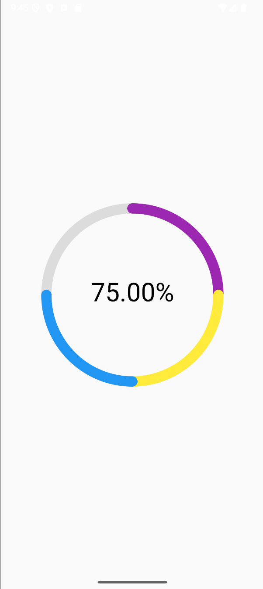
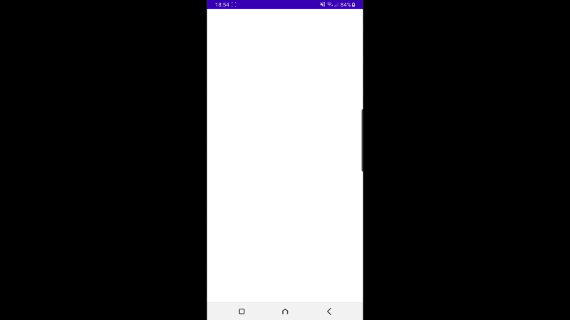
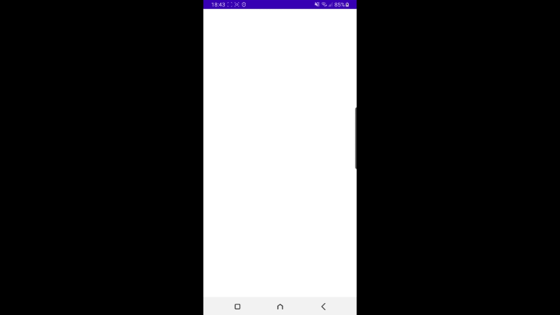
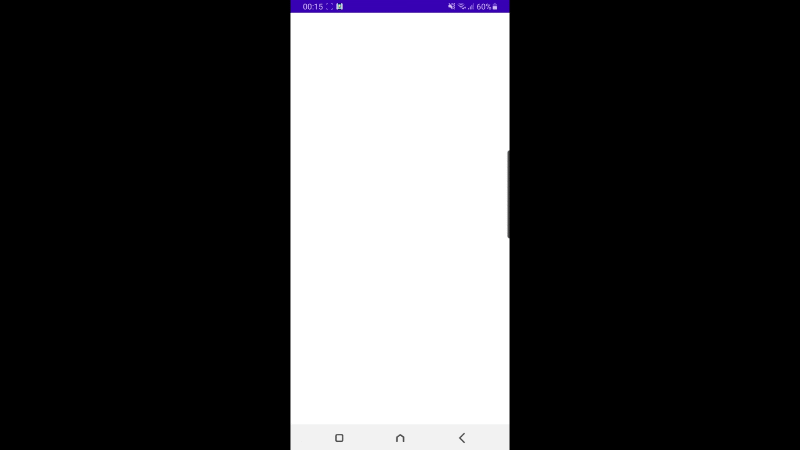

## StatsView - мини-проект по созданию кастомных View.

**Цель:** изучение API отрисовки Android (Canvas, Paint) и создание элементов интерфейса — круговых диаграмм с анимацией.

**Что реализовано:**
- Кастомная View для отображения круговой диаграммы
- Расчёт долей и процентов на основе переданных данных (SmartStatsView)
- Корректное отображение точек-разделителей между секторами (Dot)
- Анимация поворота на 360 градусов при отрисовке (Rotation)

<!-- 

  

 -->

  

  
Вариации

  

    
  

  <em>Постепенное заполнение по часовой стрелке.</em>

  

  <em>Заполнение секторами: 25% → 50% → 75% → 100%.
  </em>

Смотреть [скрины](Screen-video)

**Стек:** Kotlin, Android SDK (Canvas, Paint, View).
