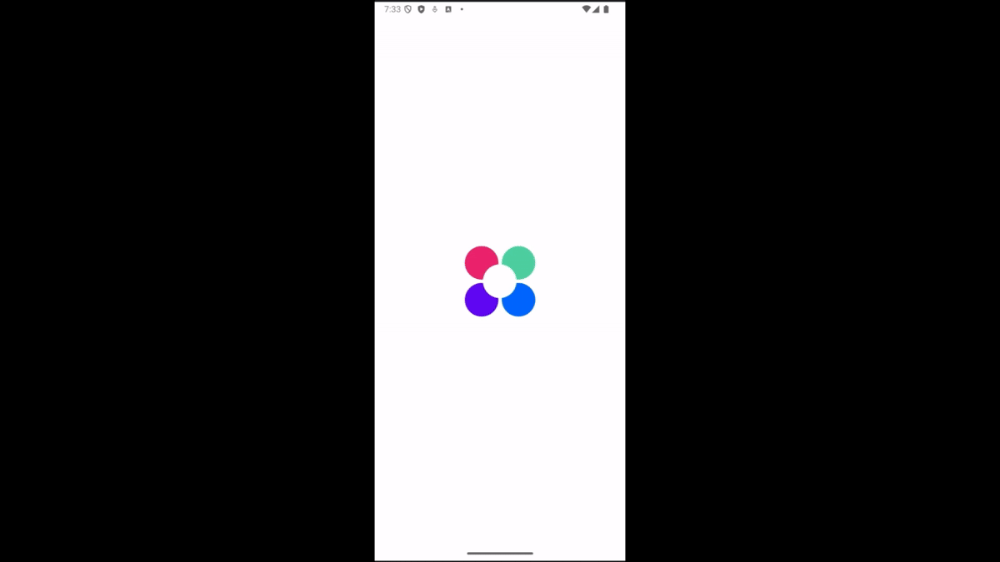

## StatsView - мини-проект по созданию кастомных View.

**Цель:** изучение API отрисовки Android (Canvas, Paint) и создание собственного элемента интерфейса — круговой диаграммы с анимацией.

**Что реализовано:**
- Кастомная View для отображения круговой диаграммы (Canvas, Paint)
- Расчёт долей и процентов на основе переданных данных (SmartStatsView)
- Корректное отображение точек-разделителей между секторами (Dot)
- Поддержка незаполненной части диаграммы (Not Filled)
- Анимация поворота на 360 градусов при отрисовке (Rotation), текст остаётся неподвижным

**Демонстрация:**

  

Смотреть [скрины](Screen-video)

**Стек:** Kotlin, Android SDK (Canvas, Paint, View).
